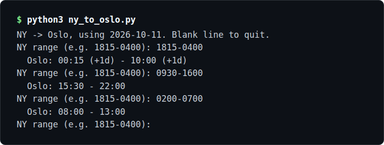

# manual_codes

Small personal Python scripts, two so far. One converts a New York clock-time
session range to Oslo time. The other watches MNQ futures and sends an ntfy.sh
alert when price touches a prior Asia, London or New York session high or low.

*`ny_to_oslo.py` turning New York session ranges into Oslo local time.*

## What it does

- `ny_to_oslo.py`: converts a New York clock-time session range (e.g. `1815-0400`)
  to Oslo local time, handling the overnight wrap and marking results that land
  on the next day with `(+1d)`. Run `python3 ny_to_oslo.py`, type a range, and
  press Enter on a blank line to quit.
- `mnq_level_watch.py`: fetches MNQ bars from the TopstepX (ProjectX) API, tracks
  prior Asia/London/New York session highs and lows, and sends an ntfy.sh alert
  the first time price touches an untouched level. It makes one pass and exits,
  so run it on a repeating schedule. Needs `~/mnq.env` with
  `PROJECT_X_USERNAME` and `PROJECT_X_API_KEY`, and an `NTFY_TOPIC` env var to
  enable alerts.
- Each `mnq_level_watch.py` run prints the last price, how many levels are
  tracked and how many are still untouched, and the fresh hits (levels touched
  in the last 15 minutes of data that were not alerted before).

## How it works

Both scripts are plain Python (3.9 or newer, for `zoneinfo`). `ny_to_oslo.py`
converts between the `America/New_York` and `Europe/Oslo` zones for today's
date, so the daylight-saving shifts of both places are handled.
`mnq_level_watch.py` logs in to the TopstepX API with an API key, finds the MNQ
contract and pulls the last 15 days of bars into a pandas DataFrame using
`requests`, with credentials read through `python-dotenv`. It splits the bars
into sessions by New York clock time (Asia 20:00-01:00, London 03:00-09:30,
New York 09:30-16:00), takes each earlier session's high and low as levels, and
checks which later bars have traded through them. Levels touched within the last
15 minutes of data that are not yet in `~/mnq_hit_levels.txt` trigger an alert,
and that file is rewritten so each level alerts once.

## Status

Two scripts so far, more incoming. Not done yet: I am working on an ESP32
temperature and humidity sensor for vivariums, terrariums and paludariums, and
an English/Norwegian to Yoda translator. I will also expand `mnq_level_watch.py`
into a proper indicator and perhaps a full strategy that mimics my live trading
strategy, in hopes of finally automating it.
